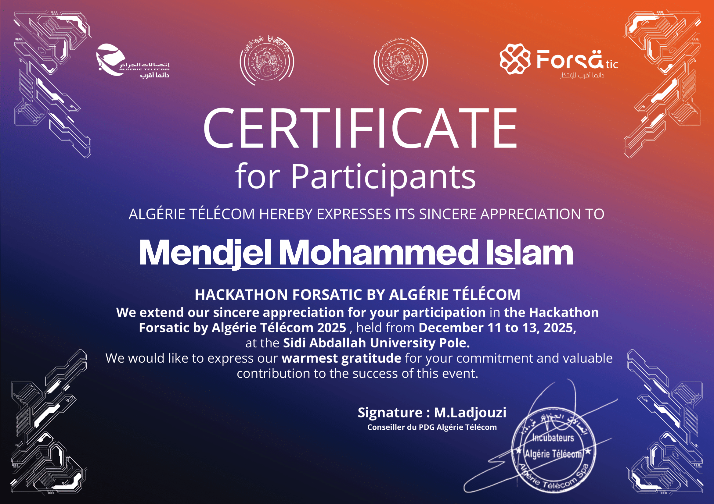

<div align="center">


</div>

<div align="center">

[](https://github.com/islamMendjel)

</div>

<div align="center">

[](https://github.com/islamMendjel)
[](https://github.com/islamMendjel)
[](https://github.com/islamMendjel?tab=followers)
[](https://www.linkedin.com/in/islammendjel/)
[](mailto:gamerislam21@gmail.com)

</div>

---

## ⚡ About Me

```python
class IslamMendjel:
    location   = "Guelma, Algeria 🇩🇿"
    education  = "Master 1 STIC — Université 8 Mai 1945 Guelma"
    focus      = "AI Backend Engineering"
    currently  = "Building AI gateways, terminal editors, and streaming apps"

    def stack(self):
        return {
            "languages" : ["C17", "TypeScript", "Python", "Java", "JavaScript"],
            "frontend"  : ["Next.js 16", "React 19", "Tailwind CSS v4", "shadcn/ui"],
            "backend"   : ["Bun", "Node.js", "Prisma", "SQLite", "PostgreSQL"],
            "systems"   : ["POSIX", "termios", "Arch Linux", "Caddy"],
            "ai"        : ["LLM routing", "SSE streaming", "prompt engineering"],
            "embedded"  : ["Arduino", "ESP32", "Raspberry Pi", "sensors"],
        }

    def ask_me_about(self):
        return ["AI backends", "embedded systems", "Linux ricing", "modal editors"]

    def fun_fact(self):
        return "I wrote a terminal IDE in pure C17 with zero dependencies."
```

---

## 🚀 Featured Projects

<table>
<tr>
<td width="50%" valign="top">

### 🤖 [Senku — AI Gateway](https://senku.space-z.ai)
Personal AI gateway with pooled key routing, 3-tier token pacing, grounded search, Duel Mode (two models race one prompt), effort dial (Fast/Medium/Deep), file understanding, and a word-by-word typewriter UI. Built with **Next.js 16 · Bun · Prisma · TypeScript**.

[](https://github.com/islamMendjel/SenkuAPI)
[](https://senku.space-z.ai)

</td>
<td width="50%" valign="top">

### 🎬 [Senku-frameXTV](https://senkuframextv.space-z.ai)
Cinematic streaming PWA with Arabic-first subtitles, multi-server video failover, personal watchlist, bilingual search, and a Waybar-inspired dark UI. Powered by FrameXTV. Built with **Next.js 16 · Bun · Prisma · TypeScript**.

[](https://github.com/islamMendjel/SenkuFrameXTV)
[](https://senkuframextv.space-z.ai)

</td>
</tr>
<tr>
<td width="50%" valign="top">

### ⌨️ [SenkuVim](https://github.com/islamMendjel/SenkuVim)
Zero-dependency modal terminal IDE written in **pure C17** for Arch Linux. FSM syntax highlighter, transaction-based undo/redo stack, smart tabs, auto-pairs, and a 24-bit TrueColor Waybar pill UI themed after the Rick Sanchez Arch rice palette. Zero external libraries. ASan/UBSan verified.

[](https://github.com/islamMendjel/SenkuVim)
[](https://github.com/islamMendjel/SenkuVim)

</td>
<td width="50%" valign="top">

### 📡 [Senku Stream](https://github.com/islamMendjel/SenkuStream)
PWA streaming site built on the TMDB API with a clean, mobile-first interface. Discover and browse movies and series with real-time search and smooth navigation.

[](https://github.com/islamMendjel/SenkuStream)

</td>
</tr>
</table>

---

## 🛠️ Tech Stack

### Languages


### Frontend & UI


### Backend & Infrastructure


### Systems & Embedded


### AI & Tools


---

## 📊 GitHub Stats

<div align="center">


&nbsp;&nbsp;


</div>

<div align="center">

[](https://github.com/islamMendjel)

</div>

---

## 🏆 GitHub Trophies

<div align="center">

[](https://github.com/islamMendjel)

</div>

---

## 🏅 Certifications

<div align="center">

[](https://github.com/islamMendjel/islamMendjel/blob/main/forsa.pdf)

*Forsa Hackathon — Click to view PDF*

</div>

---

## ✍️ Dev Quote

<div align="center">

[](https://github.com/islamMendjel)

</div>

---

## 🤝 Connect

<div align="center">

[](https://www.linkedin.com/in/islammendjel/)
[](mailto:gamerislam21@gmail.com)
[](https://www.facebook.com/mendjel.islam)
[](https://www.instagram.com/islam.mendjel/)

</div>

---

<div align="center">


</div>
