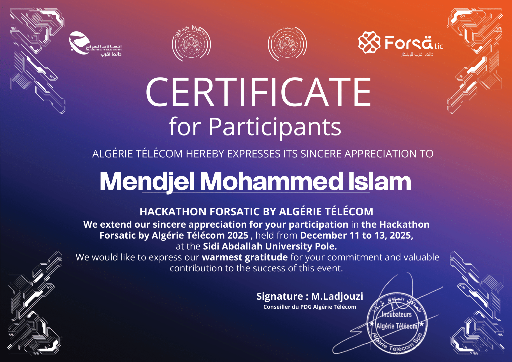

#  

&nbsp;&nbsp;&nbsp;&nbsp;&nbsp;&nbsp;&nbsp;&nbsp;&nbsp;

> [!NOTE]
> The "Last Login" date below is updated manually by Me every day!

Last Login to GitHub: **November 07 2026**

&nbsp;

---

- 🎓 Master 1 STIC student at **Université 8 Mai 1945 Guelma**, Algeria
- 🤖 Building toward a career as an **AI Backend Engineer**
- 🛠️ Currently shipping: **Senku** (personal AI gateway) · **SenkuFrameXTV** (streaming PWA) · **SenkuVim** (terminal IDE in pure C17)
- 💬 Ask me about **AI backends, embedded systems, Linux ricing, Next.js**
- 📫 How to reach me: **[gamerislam21@gmail.com](mailto:gamerislam21@gmail.com)**
- ⚡ Fun fact: I wrote a full modal terminal IDE from scratch in pure C17 — zero dependencies, zero ncurses

**Connect with me**

&nbsp;&nbsp;&nbsp;

---

## 🚀 Featured Projects

| Project | Description | Stack | Link |
|---|---|---|---|
| **Senku** | Personal AI gateway — pooled key routing, 3-tier token pacing, grounded search, Duel Mode, Effort Dial, file understanding, word-by-word streaming | Next.js 16 · Bun · Prisma · TypeScript |   |
| **Senku-frameXTV** | Cinematic streaming PWA — Arabic-first subtitles, multi-server failover, watchlist, bilingual search | Next.js 16 · Bun · Prisma · TypeScript |   |
| **SenkuVim** | Zero-dependency modal terminal IDE in pure C17 — FSM syntax highlighter, undo/redo stack, Waybar pill UI, 24-bit TrueColor | C17 · POSIX · GCC |  |
| **Senku Stream** | PWA streaming site built on the TMDB API | Next.js · TypeScript |  |

---

### Languages and Tools

&nbsp;&nbsp;&nbsp;&nbsp;)&nbsp;&nbsp;&nbsp;&nbsp;&nbsp;&nbsp;&nbsp;&nbsp;&nbsp;&nbsp;&nbsp;&nbsp;&nbsp;&nbsp;&nbsp;&nbsp;&nbsp;&nbsp;&nbsp;&nbsp;&nbsp;&nbsp;&nbsp;&nbsp;&nbsp;&nbsp;&nbsp;&nbsp;&nbsp;&nbsp;&nbsp;&nbsp;&nbsp;&nbsp;&nbsp;&nbsp;&nbsp;&nbsp;&nbsp;&nbsp;&nbsp;&nbsp;&nbsp;&nbsp;&nbsp;&nbsp;&nbsp;&nbsp;&nbsp;&nbsp;&nbsp;&nbsp;&nbsp;&nbsp;&nbsp;&nbsp;&nbsp;&nbsp;&nbsp;&nbsp;&nbsp;&nbsp;&nbsp;&nbsp;&nbsp;&nbsp;&nbsp;&nbsp;&nbsp;&nbsp;&nbsp;&nbsp;&nbsp;&nbsp;&nbsp;&nbsp;&nbsp;&nbsp;&nbsp;&nbsp;&nbsp;&nbsp;&nbsp;&nbsp;&nbsp;&nbsp;&nbsp;&nbsp;&nbsp;&nbsp;&nbsp;&nbsp;&nbsp;&nbsp;&nbsp;&nbsp;

---

## 🏆 GitHub Trophies

## 📊 GitHub Stats

### &nbsp;&nbsp;&nbsp;&nbsp;

---

## ⬆️ My Streak

### 

---

## 🏅 Certifications

  
*Click image to view official PDF*

## ✍️ Random Dev Quote

&nbsp;&nbsp;

